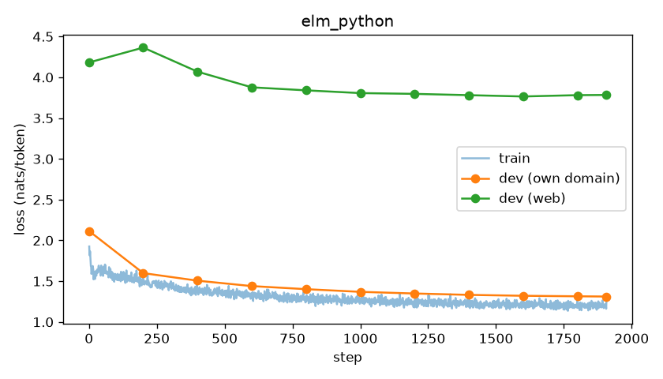
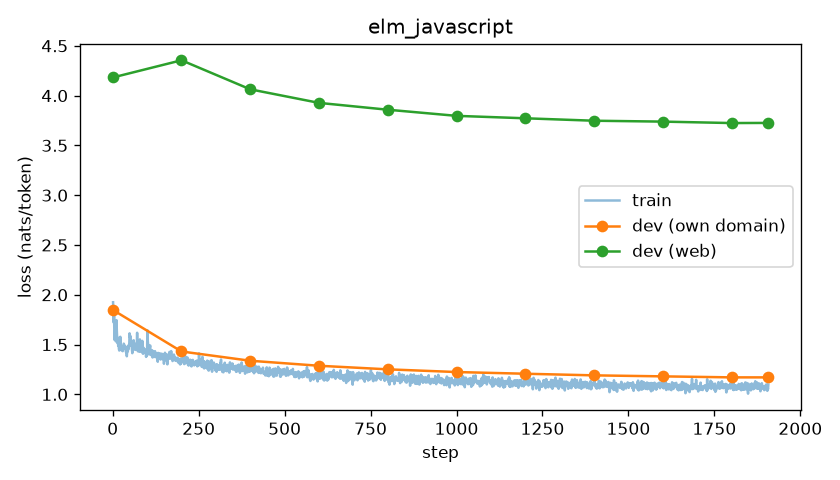
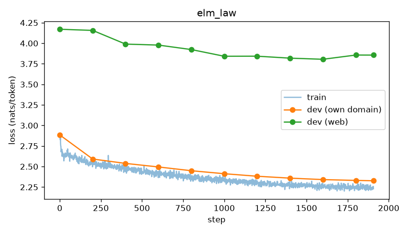

# BTM-Repeat

A small-scale replication of **Branch-Train-Merge** ([Li et al., 2022](https://arxiv.org/abs/2208.03306)): train separate expert language models (ELMs) on separate domains with no communication between them, then combine them by output ensembling or parameter averaging.

This repo is a frozen baseline (tag `btm-baseline-v1`) for later distillation and merge experiments.

## Setup

| | |
|---|---|
| Seed | `EleutherAI/pythia-160m-deduped` (step 143000) |
| Experts | **python** and **javascript** branched from the seed; **law** branched from a posterior-weighted average of {seed, python, javascript} (a second BTM iteration) |
| Training | 1.0B tokens per expert, identical hyperparameters and data order, fresh AdamW, 1× H100, fp32 weights + TF32 matmuls |
| Eval domains | Trained: python, javascript, law. Held-out: typescript, rust, contracts (CUAD), web (FineWeb-Edu) |
| Data | The Stack (dedup), Caselaw Access Project, CUAD, FineWeb-Edu. Splits are assigned by hashing repo / case / contract, so related documents never cross splits |
| Metric | Test perplexity over non-overlapping 1024-token windows |

```
              ┌──► python ELM ─────┐
seed ─────────┤                    ├──► Σ wθ ──► law ELM
(Pythia-160M) ├──► javascript ELM ─┤    w = 0.95 seed · 0.01 py · 0.04 js
              └────────────────────┘
```

Combination methods:

- **Ensemble:** `p(x_t) = Σ_j p_j(x_t | x_<t) · P(j | x_<t)`. The posterior over experts is updated token by token from a prior. The *cached* prior is estimated on 100 dev windows of the target domain; the *uniform* prior uses no target-domain information.
- **Parameter average:** `θ = Σ_j w_j θ_j`. Uniform (1/3 each) or posterior-weighted (w = the cached prior).

## Results

Test perplexity (lower is better):

| model | python | javascript | law | typescript | rust | contracts | web |
|---|---|---|---|---|---|---|---|
| Seed | 7.02 | 7.59 | 18.81 | 7.70 | 5.46 | 13.61 | 49.71 |
| Python ELM | **3.44** | 5.06 | 31.03 | 5.56 | 5.57 | 19.58 | 42.97 |
| JavaScript ELM | 5.64 | **3.16** | 28.60 | **3.70** | 5.71 | 17.99 | 41.08 |
| Law ELM | 46.50 | 75.55 | **10.07** | 69.23 | 50.59 | 13.07 | 42.37 |
| Ensemble, cached prior | **3.44** | **3.16** | **10.07** | **3.70** | 5.52 | **12.73** | **37.73** |
| Ensemble, uniform prior | 3.45 | 3.16 | 10.08 | 3.70 | 5.53 | 12.74 | 37.73 |
| Ensemble, top-1 | 3.44 | 3.16 | 10.07 | 3.70 | 5.57 | 13.07 | 41.08 |
| Ensemble, top-2 | 3.44 | 3.16 | 10.07 | 3.70 | 5.52 | 12.75 | 37.94 |
| Param avg, uniform | 4.83 | 4.51 | 27.48 | 4.97 | 5.93 | 19.77 | 56.59 |
| Param avg, posterior | 3.44 | 3.16 | 10.07 | 3.70 | **5.23** | 12.96 | 56.02 |

### Findings

1. **Experts specialize strongly.** Each expert cuts perplexity on its own domain by 46–58% vs the seed. The JavaScript expert transfers to TypeScript (7.70 → 3.70).
2. **They pay for it off-domain.** The law expert is about 10× worse than the seed on code (JavaScript 75.5 vs 7.6); the code experts are worse on law and contracts.
3. **No forgetting on general text.** Web perplexity *fell* 14–17% for every expert. This is likely a shift toward FineWeb-Edu style rather than true improvement, and is worth checking.
4. **The ensemble matches the right expert in-domain.** The cached prior puts ≈1.0 weight on the matching expert for python, javascript, law and typescript, so the ensemble, top-1 and the posterior-weighted average all reduce to that single expert there.
5. **Off-domain, ensembling beats averaging.** On web the ensemble is 24% better than the seed, while both parameter averages are 13–14% *worse* than the seed. Uniform averaging is worse than the matching expert everywhere.
6. **One exception: Rust.** The posterior-weighted average (python 0.64 / javascript 0.36) gets 5.23, beating both the ensemble (5.52) and the seed (5.46).
7. **The second BTM iteration barely moved the law init.** Branching weights came out as 0.95 seed / 0.01 python / 0.04 javascript, so the law init's dev loss (2.933) is essentially the seed's (2.928). Law effectively branched from the seed.
8. **A uniform prior costs almost nothing.** Uniform-prior ensembling is within 0.4% of the cached prior on every domain, so routing does not need target-domain labels at this scale.

Full report, including prior weights, posterior entropy and the law init check: [`results/REPORT.md`](results/REPORT.md).

### Training curves

| python | javascript | law |
|---|---|---|
|  |  |  |

## Deviations from the paper

- A public pretrained seed (Pythia-160M-deduped, ~300B tokens) replaces BTM's own seed phase. It has seen Pile domains, including GitHub and FreeLaw, so some test data may overlap with pretraining.
- Each expert starts with a fresh AdamW optimizer and warmup.
- 3 domains and 2 BTM iterations; the seed is included as a candidate when averaging for branching.
- Law data comes from `TeraflopAI/Caselaw-Access-Project`.
- Training used fp32 weights with TF32 matmuls; bf16 autocast badly inflated Pythia-160M's loss.
- No compute-matched dense baseline.

## Repository layout

```
btm/            library: data prep, loader, trainer, merge, posterior, ensemble, scoring, report
configs/        YAML configs for data, the base trainer, each ELM and eval
scripts/        pod setup, sync, job launch and phase scripts (RunPod, run over SSH + tmux)
tests/          CPU unit tests on tiny random GPT-NeoX models
results/        report, CSVs, priors, training curves
artifacts/      MANIFEST.json: checksums for every checkpoint, data split, config and result
BTM_PLAN.md     the full step-by-step plan this project followed
```

`btm/ensemble.py` also provides `EnsembleLM`, which returns full-vocabulary mixed distributions; it is the intended teacher for future distillation work.

## Reproducing

Follow [`BTM_PLAN.md`](BTM_PLAN.md) phase by phase. Exact package versions are in `requirements.lock`. Unit tests run on CPU:

```bash
pip install -r requirements.txt torch
pytest
```
