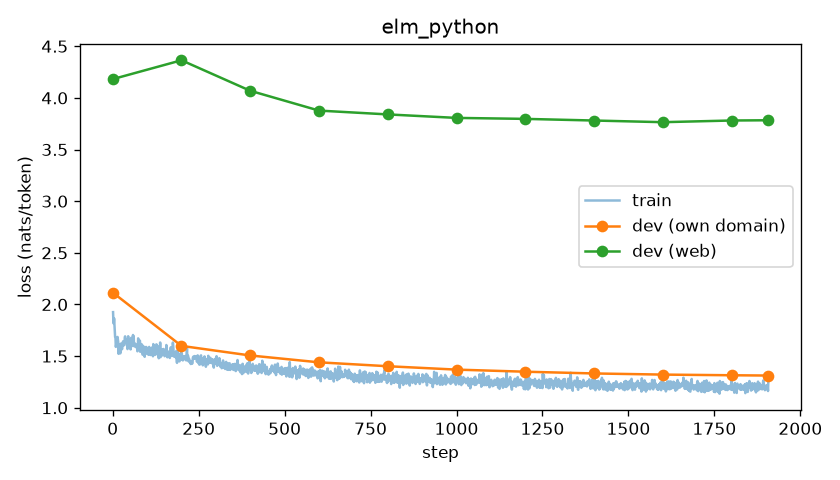
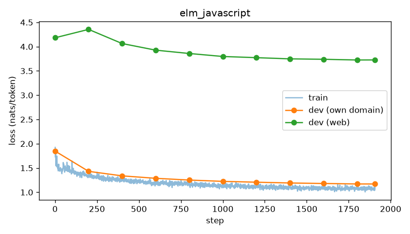
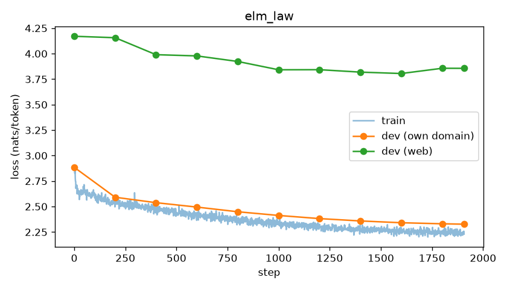

# BTM baseline report

git SHA: `fd253a8036394bf9978dfc60421a3bf235e7e34d`

## 1. Test perplexity

| model | python | javascript | law | typescript | rust | contracts | web | macro in-domain | macro held-out |
|---|---|---|---|---|---|---|---|---|---|
| M0 seed | 7.021 | 7.588 | 18.810 | 7.696 | 5.460 | 13.606 | 49.712 | 11.139 | 19.119 |
| M1 elm_python | 3.443 | 5.057 | 31.026 | 5.562 | 5.569 | 19.584 | 42.971 | 13.176 | 18.422 |
| M2 elm_javascript | 5.637 | 3.158 | 28.604 | 3.698 | 5.710 | 17.993 | 41.084 | 12.467 | 17.121 |
| M3 elm_law | 46.496 | 75.548 | 10.067 | 69.233 | 50.589 | 13.066 | 42.371 | 44.037 | 43.815 |
| E1 ensemble (cached prior) | 3.442 | 3.158 | 10.067 | 3.698 | 5.523 | 12.730 | 37.733 | 5.556 | 14.921 |
| E2 ensemble (uniform prior) | 3.445 | 3.162 | 10.078 | 3.701 | 5.526 | 12.741 | 37.734 | 5.562 | 14.925 |
| E3 ensemble (top-1) | 3.443 | 3.158 | 10.067 | 3.698 | 5.569 | 13.066 | 41.084 | 5.556 | 15.854 |
| E3 ensemble (top-2) | 3.442 | 3.158 | 10.067 | 3.698 | 5.523 | 12.750 | 37.941 | 5.556 | 14.978 |
| A1 param avg (uniform) | 4.834 | 4.513 | 27.479 | 4.968 | 5.928 | 19.766 | 56.590 | 12.275 | 21.813 |
| A2 param avg (posterior) | 3.443 | 3.158 | 10.067 | 3.698 | 5.230 | 12.955 | 56.017 | 5.556 | 19.475 |

Seed perplexity (dev / test):

| domain | dev | test |
|---|---|---|
| python | 8.259 | 7.021 |
| javascript | 8.656 | 7.588 |
| law | 18.687 | 18.810 |
| typescript | 7.715 | 7.696 |
| rust | 6.035 | 5.460 |
| contracts | 13.005 | 13.606 |
| web | 54.450 | 49.712 |

## 2. Cached prior weights (first 100 dev windows)

| domain | elm_python | elm_javascript | elm_law |
|---|---|---|---|
| python | 1.0000 | 0.0000 | 0.0000 |
| javascript | 0.0000 | 1.0000 | 0.0000 |
| law | 0.0000 | 0.0000 | 1.0000 |
| typescript | 0.0000 | 1.0000 | 0.0000 |
| rust | 0.6381 | 0.3619 | 0.0000 |
| contracts | 0.0200 | 0.0100 | 0.9700 |
| web | 0.0463 | 0.5137 | 0.4400 |

## 3. Law initialization

| candidate | weight |
|---|---|
| /workspace/btm/ckpt/seed | 0.9500 |
| /workspace/btm/ckpt/elm_python/final | 0.0100 |
| /workspace/btm/ckpt/elm_javascript/final | 0.0400 |

Law dev NLL (Gate B):

| model | law dev NLL |
|---|---|
| seed | 2.9278 |
| uniform avg of candidates | 3.6163 |
| posterior-weighted init | 2.9329 |

## 4. Posterior entropy under E1 (test)

| domain | mean_token_entropy | final_mean_elm_python | final_mean_elm_javascript | final_mean_elm_law | final_max_p10 | final_max_p50 | final_max_p90 | frac_final_max_gt_0.99 |
|---|---|---|---|---|---|---|---|---|
| python | 0.0001 | 0.9972 | 0.0028 | 0.0000 | 1.0000 | 1.0000 | 1.0000 | 1.000 |
| javascript | 0.0000 | 0.0000 | 1.0000 | 0.0000 | 1.0000 | 1.0000 | 1.0000 | 1.000 |
| law | 0.0000 | 0.0000 | 0.0000 | 1.0000 | 1.0000 | 1.0000 | 1.0000 | 1.000 |
| typescript | 0.0000 | 0.0008 | 0.9992 | 0.0000 | 1.0000 | 1.0000 | 1.0000 | 1.000 |
| rust | 0.0524 | 0.6959 | 0.3041 | 0.0000 | 0.9983 | 1.0000 | 1.0000 | 0.928 |
| contracts | 0.0068 | 0.0149 | 0.0310 | 0.9541 | 1.0000 | 1.0000 | 1.0000 | 0.997 |
| web | 0.0353 | 0.1255 | 0.3169 | 0.5576 | 1.0000 | 1.0000 | 1.0000 | 0.968 |

## 5. Training curves

## 6. Deviations from the paper

- Seed: a public pretrained seed (Pythia-160M-deduped, ~300B tokens) replaces BTM's own seed phase. There is no seed-fraction knob, and the seed has seen Pile domains, including GitHub and FreeLaw.
- Optimizer: each ELM starts with fresh AdamW and its own warmup. The paper continued the seed's optimizer state.
- Domains and iterations: 3 domains and 2 BTM iterations. The seed is included as a candidate when averaging for branching.
- Branching weights: the mean of per-window posteriors (uniform prior) over 100 dev windows.
- Law data: TeraflopAI/Caselaw-Access-Project replaces free-law/Caselaw_Access_Project (gated with manual approval).
- Hardware and precision: 1x H100 SXM instead of A100; fp32 weights with TF32 matmuls instead of bf16 autocast, because bf16 inflated Pythia-160M's loss by 20-50% and gradient norms by 20-100x. torch.compile off (slower here).
- Eval data: some evaluation data may overlap with the seed's pretraining data.
- No compute-matched dense baseline (out of scope).

**Contamination note.** The seed was trained on the Pile, which includes GitHub and FreeLaw, so some test documents may already have been seen by the seed. All models share the seed, so this inflates absolute quality but barely affects comparisons between them. No attempt was made to remove the overlap.

## Flags

- none
